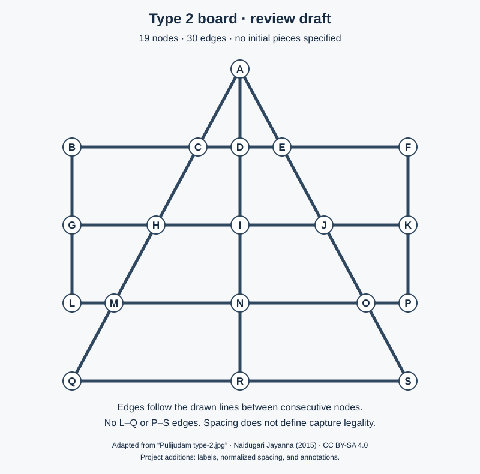

> Superseded by D010 on 2026-10-17. Historical 19-point draft only; do not use for implementation. See [current specification](../game-rules.md).

# Type 2 board and game rules

Status: **review draft, not an approved rules baseline**, 2026-10-17.
Scope: [issue #1](https://github.com/lumensparkxy/lamb-and-tiger/issues/1), M1.
No rules engine or Android implementation is authorized by this document.

## Authority and evidence

The selected board is agreed in D002. Its precise graph and all gameplay rules below still require approval. Labels, coordinates, and example positions are documentation aids created for this project, not labels found in the reference.

Sources inspected on 2026-10-17:

| ID | Source | What it establishes and its limits |
| --- | --- | --- |
| S1 | [Lambs and tigers, gallery](https://en.wikipedia.org/w/index.php?title=Lambs_and_tigers&oldid=1371891779#Gallery) | Identifies the selected image as Game type -2. The article is not a complete Type 2 rulebook. |
| S2 | [Pulijudam type-2.jpg, Naidugari Jayanna](https://commons.wikimedia.org/wiki/File:Pulijudam_type-2.jpg) | Board geometry, visually inspected at full image-viewer size. Created 2015-12-12; own work, CC BY-SA 4.0. No pieces or starting positions are marked. |
| S3 | [Digital Ludeme Project: Pulijudamu evidence](https://ludii.games/data.php?gameId=978), evidence 1840 and 1842 | Reports a 19-point game with 3 tigers and 15 lambs, placement before lamb movement, line-following steps, short-leap captures, and immobilization as the lamb objective. Describes the matching triangle/rectangle geometry. The tiger objective is qualitative: capture enough to prevent confinement. Also records regional variation in piece counts. |
| S4 | [SGADF: Lambs and Tigers](https://www.sgadf.com/games/moredetails/lambs-and-tigers-66920) | Describes 3 tigers, 15 lambs, lambs first, alternating turns, capture during placement, and no lamb jumps. Describes an apex plus two nearby inner starting points, without resolving their IDs on our selected board. Not verified as Type 2-specific. |
| S5 | [Board and Pieces: The Leopard Games](https://sites.google.com/site/boardandpieces/list-of-games/the-leopard-games) | Describes optional captures and one jump per turn for this family. This supports a policy choice, not proof of an agreed Type 2 rule. |
| S6 | [Tigers and Goats rules handout](https://static1.squarespace.com/static/59cbc7408dd04169d7183b68/t/5ec065e229a8f9652e887215/1589667312290/Tigers%2Band%2BGoats.pdf) | Describes a five-capture target and mentions six/all as alternatives. Text inspected; its board has not been established as our Type 2 board. It cannot settle our victory condition. |

S3 cites R. Vasantha, *Board Games from the City of Vijayanagara (Hampi), 1336–1565: a survey and a study*, Board Game Studies 6 (2003), pp. 25–36, specifically p. 28 and figure 5. The linked journal PDF could not be retrieved during this pass; the historical evidence above is reported through S3, not claimed as a direct reading of the paper. The Wikipedia-linked Plus game description was also unavailable. No rules from square-board Bagh-chal have been imported.

## Annotated board: candidate transcription

Interpretation for review: every visible endpoint, corner, and line intersection is a playable node. Two consecutive nodes on a drawn line share one undirected edge. No extra diagonal or connection across an unmarked area is added. This yields **19 nodes and 30 edges**.

The illustration is a geometric redrawing of S2 with new labels and normalized spacing; it does not indicate an initial position. Attribution: Naidugari Jayanna, *Pulijudam type-2.jpg* (2015); adapted for this project, [CC BY-SA 4.0](https://creativecommons.org/licenses/by-sa/4.0/). This attribution and license apply to the derived diagram, not automatically to project code.

### Node positions

Coordinates are normalized diagram coordinates, with y increasing downwards. They specify layout only; distances must not determine move legality.

| Row | Nodes, left to right: ID (x, y) |
| --- | --- |
| Apex | A (0, 0) |
| Top crossbar | B (-4, 2), C (-1, 2), D (0, 2), E (1, 2), F (4, 2) |
| Middle crossbar | G (-4, 4), H (-2, 4), I (0, 4), J (2, 4), K (4, 4) |
| Lower crossbar | L (-4, 6), M (-3, 6), N (0, 6), O (3, 6), P (4, 6) |
| Base | Q (-4, 8), R (0, 8), S (4, 8) |

### Complete edge definition

Each row below is one straight drawn line, in order. **Only consecutive pairs** are edges; for example, B–D is not an ordinary step because C lies between them.

| Line | Ordered nodes | Edges |
| --- | --- | ---: |
| Left triangle side | A–C–H–M–Q | 4 |
| Centre | A–D–I–N–R | 4 |
| Right triangle side | A–E–J–O–S | 4 |
| Top crossbar | B–C–D–E–F | 4 |
| Middle crossbar | G–H–I–J–K | 4 |
| Lower crossbar | L–M–N–O–P | 4 |
| Base | Q–R–S | 2 |
| Left rectangle side | B–G–L | 2 |
| Right rectangle side | F–K–P | 2 |

The rectangle sides end at L and P. In particular, **L–Q and P–S are not edges**, despite their vertical alignment in the normalized drawing. B–A and F–A are also absent.

### Candidate capture paths

Pending approval of straight short-leap capture, use precisely three consecutive nodes on one of the lines above: origin, occupied lamb node, empty landing node. Both directions of each triple below are candidates. A turn at a corner/intersection is not a straight leap. Neither equal pixel spacing nor arbitrary two-edge reachability establishes a capture.

| Line | Triples (also valid in reverse, subject to occupancy and policy) |
| --- | --- |
| Left triangle side | A–C–H; C–H–M; H–M–Q |
| Centre | A–D–I; D–I–N; I–N–R |
| Right triangle side | A–E–J; E–J–O; J–O–S |
| Top crossbar | B–C–D; C–D–E; D–E–F |
| Middle crossbar | G–H–I; H–I–J; I–J–K |
| Lower crossbar | L–M–N; M–N–O; N–O–P |
| Base | Q–R–S |
| Left rectangle side | B–G–L |
| Right rectangle side | F–K–P |

There are **21 undirected triples / 42 directed capture paths** under this interpretation. These are geometry candidates, not a claim that captures are legal regardless of whose turn it is or what occupies the nodes.

## Rules awaiting decisions

Nothing in this table is approved merely because a source describes it. Confirm the source-backed candidates or provide the intended regional/family rules. Open choices must not become implementation defaults.

| ID | Topic | Review candidate or missing decision |
| --- | --- | --- |
| R01 | Board | Confirm the 19-node, 30-edge transcription and 42 directed straight capture paths above. |
| R02 | Pieces and initial state | S3 supports 3 tigers and 15 lambs. Confirm these counts, whether all tigers start on-board, and the exact tiger node IDs. S2 supplies no initial pieces. With 3 tigers, specify all 3 IDs; an apex plus two other nodes cannot be selected unambiguously from the sources. |
| R03 | Turns and placement | Candidate from S3/S4: lambs begin with all lambs in reserve; alternate sides, one action each turn. A lamb turn places one reserve lamb on an empty node until reserve is exhausted. Placed lambs cannot move during this phase. Tigers may step or capture during placement. Confirm. |
| R04 | Movement and removal | Candidate from S3/S4: after the last lamb is placed, the tiger takes the next turn; subsequent lamb turns move one lamb along an edge to an empty node. Tigers likewise step to an empty neighbour or capture. Lambs never jump or capture; captures remove lambs permanently, without replenishing reserve. Confirm. |
| R05 | Capture policy | Confirm straight short leaps as listed above. S5 supports optional captures and a single jump per turn; confirm optional versus mandatory, and single jump versus chains. If chains are chosen, stopping obligations need a separate decision. |
| R06 | Lamb victory | Candidate from S3: all tigers have neither an ordinary step nor a capture. Confirm whether to end immediately when this occurs, including during placement. One immobilized tiger alone does not meet this candidate condition. |
| R07 | Tiger victory | Unresolved. S3 does not provide a numeric threshold or an algorithm for proving confinement impossible. S6 describes 5, with 6/all as variants on an unverified board. Choose the intended condition; no threshold has been adopted or proved sufficient on this graph. |
| R08 | Lamb side without a legal action | Unresolved: decide loss, draw, pass, or another explicit rule, including any placement-phase case. Do not assume symmetry with tiger immobilization. |
| R09 | Repetition and other draws | Unresolved: decide whether repetitions are allowed, prohibited, or end in a draw; if counted, specify count and state equivalence (board, side to move, reserve/captured counts, phase). Decide whether any no-progress/turn limit or agreed draw exists. No limit has been invented. |
| R10 | Ending precedence | After R06–R09 are chosen, specify when outcomes are checked and which takes priority if conditions coincide. No further moves are allowed once the selected outcome is terminal. |

## Concrete examples for review and later tests

These are **conditional specification fixtures**, not executed engine tests. They assume R01's graph and the candidate rules identified in each example. Tactical examples describe only the relevant pieces; other pieces must not occupy named empty nodes. Full-match reachability has not been established. Once rules are approved, expand each into a complete state and expected transition.

| ID | Position/action | Conditional expected result |
| --- | --- | --- |
| E01 | Lamb turn, reserve positive, D empty: place a lamb at D. | Legal under R03; reserve decreases by one, D becomes occupied, tiger turn follows. |
| E02 | Same turn, but D already contains either species: place at D. | Illegal; no state or turn change. |
| E03 | Lamb at C, D empty, reserve still positive: move C→D. | Illegal under R03; placement must finish first. |
| E04 | Lamb at C, D empty, reserve zero, lamb turn: C→D. | Legal under R04. C→I is illegal: no edge connects them. |
| E05 | Tiger at A, D empty, tiger turn: A→D. | A valid ordinary step; if R05 makes capture mandatory, eligibility also depends on whether any capture is available. A→I is not an ordinary step because D intervenes. |
| E06 | Tiger at A, lamb at C, H empty: A→H over C. | Legal under straight short-leap capture; A and C become empty, H contains the tiger, captured count increases by one. Reserve is unchanged. |
| E07 | E06 with H occupied, or C empty, or C occupied by a tiger. | Each case is illegal. A landing must be empty and exactly the intervening lamb is captured. |
| E08 | Tiger at B, lamb at C, D empty: B→D over C. | Legal under R05 even though the diagram's B–C and C–D lengths differ. They are consecutive nodes on one line. |
| E09 | Tiger at B, lamb at C, H empty: B→H over C. | Illegal under straight capture: the two edges turn at C. |
| E10 | Piece at L, Q empty: L→Q. | Illegal; the source has no connecting line segment. |
| E11 | Lamb at A, tiger at C, H empty: lamb jumps A→H. | Illegal under R04; lambs do not jump or capture. |
| E12 | Tiger at A, lambs at C and M, H and Q empty: jump A→H over C, then H→Q over M in one turn. | Under S5's single-jump candidate, the turn ends at H and the second jump is forbidden. Under a chain rule the outcome needs the chosen policy. |
| E13 | Tiger at A, lamb at C, H and D empty: choose A→D instead of A→H. | Legal only if R05 permits declining an available capture. |
| E14 | Reserve is 1; earlier captures have occurred; place that final reserve lamb on an empty node. | Under R03/R04, reserve becomes 0 and the next turn belongs to tigers. On the next lamb turn, surviving lambs can move; captured lambs need not be replaced. |

### Terminal and non-terminal positions

**E15 — all tigers immobilized.** Synthetic full state for the 3/15 candidate: tigers at `{A, B, F}`, lambs at `{C, D, E, G, H, I, J, K, L, M, N, O, P, Q, S}`, empty `{R}`, reserve 0, captured 0, tiger to move. Every tiger neighbour and every possible landing from those tigers is occupied. Under R06 this is a lamb victory. This is a terminal-state fixture, not a proposed start or a proven reachable position.

**E16 — a step blocked but capture available.** Tigers `{A, B, F}`, lambs `{C, D, E, G, I, J, K, L, M, N, O, P, Q, R, S}`, empty `{H}`, reserve 0, captured 0, tiger to move. A can capture C by landing at H. Under R06 the lambs have **not** won, even though A has no empty ordinary neighbour.

**E17 — tiger victory boundary.** Blocked pending R07. Once a numeric target K is explicitly chosen, include a complete legal capture taking captured count from K−1 to K, and a neighbouring non-terminal example below K. If a qualitative condition is chosen instead, define a decidable predicate and fixtures for it. Do not silently use five.

**E18 — draw/no-action boundary.** Blocked pending R08–R10. Add a complete lamb-no-action position, a repetition sequence with side-to-move checks, and any selected turn-limit boundary. No expected result is asserted yet.

## Review status and completion gate

- Source image visually inspected; candidate graph and diagram prepared.
- Document consistency checked: 19 nodes, 30 edges, 21 reversible capture triples, agreement with the listed paths, and the E15/E16 geometric conditions. SVG rendered and visually inspected; local document links and Git whitespace checks passed. These checks do not establish rule approval, fixture reachability, or gameplay correctness.
- R01–R10 need explicit decisions. Record approvals in `docs/decisions.md` and revise this document to distinguish approved rules from remaining gaps.
- E01–E16 are conditional examples; E17–E18 cannot be finalized before outcome policy is chosen.
- Issue #1 remains open. Do not start issue #2, scaffold modules, implement the engine, or claim automated gameplay/device/release evidence as part of this step.
