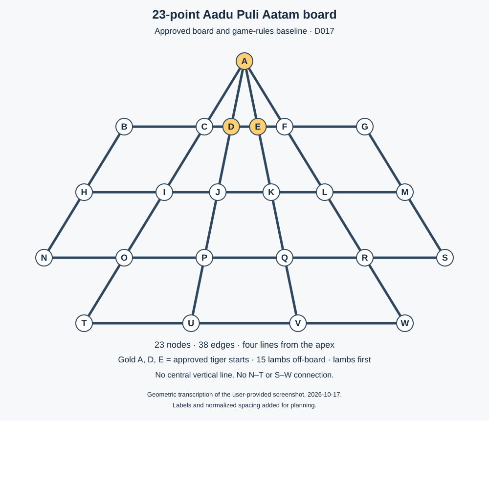

# 23-point Aadu Puli Aatam board and game rules

Current implementation status: D041 authorizes continuous Solo-first work; see the [engine/app verification record](../implementation/solo-first-evidence.md). Statements below about unimplemented tests and NEXT describe the original specification-review boundary. The approved rules are unchanged.

Status: **approved game-rules baseline for issue #1 (D017)**, 2026-10-17. D010 selects the board; D011–D016 define setup, turns, movement, captures, wins, draws, and invalid-state handling. D017 approves the complete mapping, specification, and reviewed examples.
Scope: issue #1, M1. No engine or Android implementation is part of this step.

## Decision and source authority

The user approved switching to the 23-point board and supplied `Screenshot 2026-10-17 at 18.49.03.png`. This supersedes the 19-point Type 2 choice in D002. The [earlier draft](archive/type-2-game-rules.md) and [earlier diagram](type-2-board.svg) are retained only as historical material. Old node IDs and example positions must not be used with this board.

The screenshot is the visual authority for the new geometry: four rays from the apex, three crossing horizontal lines with sloping outer sides, and a base. It has no central vertical ray and no marked starting pieces. The screenshot's checkerboard background and viewer arrow are not game elements. The drawing below normalizes spacing and adds labels. Source artwork authorship/license is not established; this planning diagram is not a cleared release asset.

Supporting references inspected on 2026-10-17:

| ID | Reference | Evidence and limit |
| --- | --- | --- |
| S1 | User-provided screenshot, 2026-10-17 at 18.49.03 | Approved board selection. Endpoints and intersections transcribe to 23 nodes; no starting pieces or textual rules are shown. |
| S2 | [Traditional Games: Aadu Puli Attam](https://www.traditionalgames.co.in/aadu-puli-attam) | Text describes an apex tiger plus two nearby inner positions, 3 tigers/15 goats, lambs off-board and moving first. Its illustrated board has two internal rays. Mapping that description to our labels gives the A, D, E setup subsequently approved in D011. This is an explicit interpretation, not labels supplied by the source. Its victory wording is inconsistent; it cannot settle our ending policy. |
| S3 | [Funskool Goats & Tigers instructions](https://funskoolindia.com/wp-content/uploads/2024/09/9548100-Goats-Tigers-2022-Instructions.pdf) | Describes a setup variant: apex tiger, with the other two selected from four nearby points. This shows why the exact setup must be recorded rather than called universal. |
| S4 | [Board and Pieces: The Leopard Games](https://sites.google.com/site/boardandpieces/list-of-games/the-leopard-games) | Supports optional captures and one jump per turn within the game family; not automatic authority for every rule on this board. |

## Annotated board and approved setup

Count: **1 apex + 6 top + 6 middle + 6 lower + 4 base = 23 nodes**.

Every visible endpoint, corner, and intersection is treated as a node. Only consecutive nodes along a drawn line are adjacent. This approved transcription gives **38 undirected edges**. Node IDs A–W are new project labels, not a migration of the old A–S graph.

Gold marks show the **approved starting setup (D011)**: 3 tigers at **A, D, E**, all 15 lambs off-board in reserve, and lambs play first. Turns and placement are approved in D012 and movement/captures in D013 below; win conditions are approved in D014. D015 approves draws; D016 approves lamb-no-action error handling.

### Node positions

Coordinates below are normalized layout coordinates with y increasing downwards. Physical distance does not determine legal moves.

| Row | Nodes left to right, with x coordinates | y |
| --- | --- | ---: |
| Apex | A: 0 | 0 |
| Top | B: −3; C: −1; D: −1/3; E: 1/3; F: 1; G: 3 | 2 |
| Middle | H: −4; I: −2; J: −2/3; K: 2/3; L: 2; M: 4 | 4 |
| Lower | N: −5; O: −3; P: −1; Q: 1; R: 3; S: 5 | 6 |
| Base | T: −4; U: −4/3; V: 4/3; W: 4 | 8 |

### Complete approved edge definition

Each row defines a straight drawn line. Only consecutive pairs are ordinary edges. No centre line is added. The outer crossbar sides stop at N and S: **N–T and S–W are absent**.

| Line | Ordered nodes | Edge count |
| --- | --- | ---: |
| Left triangle side | A–C–I–O–T | 4 |
| Left inner line | A–D–J–P–U | 4 |
| Right inner line | A–E–K–Q–V | 4 |
| Right triangle side | A–F–L–R–W | 4 |
| Top crossbar | B–C–D–E–F–G | 5 |
| Middle crossbar | H–I–J–K–L–M | 5 |
| Lower crossbar | N–O–P–Q–R–S | 5 |
| Base | T–U–V–W | 3 |
| Left outer side | B–H–N | 2 |
| Right outer side | G–M–S | 2 |

### Approved capture paths

Under the straight short-leap rule approved in D013, the complete approved path transcription is every consecutive triple below, in both directions. The middle node must contain a lamb and the landing must be empty; origin must contain the acting tiger. Turning at an intersection or skipping extra nodes is excluded under the approved rule. Unequal drawing distances are irrelevant.

| Line | Triples, also considered in reverse |
| --- | --- |
| Left triangle side | A–C–I; C–I–O; I–O–T |
| Left inner line | A–D–J; D–J–P; J–P–U |
| Right inner line | A–E–K; E–K–Q; K–Q–V |
| Right triangle side | A–F–L; F–L–R; L–R–W |
| Top crossbar | B–C–D; C–D–E; D–E–F; E–F–G |
| Middle crossbar | H–I–J; I–J–K; J–K–L; K–L–M |
| Lower crossbar | N–O–P; O–P–Q; P–Q–R; Q–R–S |
| Base | T–U–V; U–V–W |
| Left outer side | B–H–N |
| Right outer side | G–M–S |

Count: **28 reversible triples / 56 directed capture paths**. The path transcription is approved in D017/R01. D013 approves optional captures and forbids chains; occupancy, turn, and game status still determine whether a particular capture is legal.

## Approved turns and placement (D012)

The user approved these six rules on 2026-10-17:

1. Players alternate: **lamb → tiger → lamb → tiger**.
2. During placement, each lamb turn adds **one off-board lamb to any empty point**. Lambs already placed cannot move.
3. On each tiger turn, the player acts with **one tiger**. Tigers may move or capture during the lamb-placement phase; capture mechanics are now approved in D013.
4. Captured lambs leave permanently and **do not return to the off-board supply**.
5. After the **15th lamb has been placed**, the tiger takes its normal turn. On subsequent lamb turns, the player moves one surviving lamb instead of placing.
6. Placement finishes when the off-board supply reaches zero—even if earlier captures mean fewer than 15 lambs remain on the board.

These rules describe turn/phase progression while a game is ongoing. D014 now defines wins and immediate ending; D015 defines draws; D016 defines lamb-no-action error handling; D017 approves the labelled graph transcription. Movement and capture mechanics are now approved in D013. The separate role-selection/rematch proposal was not approved by this decision.

## Approved movement and captures (D013)

The user approved these six rules on 2026-10-17:

1. **Ordinary move:** move one piece along a drawn line to the immediately adjacent **empty point**.
2. **Lamb movement:** allowed only after all 15 lambs have been placed. Lambs **cannot jump or capture**.
3. **Tiger capture:** jump over one adjacent lamb, following the **same straight line**, and land on the empty point immediately beyond it. Remove that lamb.
4. **No turning or skipping:** a capture cannot turn at an intersection, skip extra points, or jump over another tiger.
5. **Captures are optional:** a tiger may make an ordinary legal move even when a capture is available.
6. **One jump per turn:** no chained captures. The turn ends after the capture.

Approved illustrative distinction on the labelled board: A→I over a lamb at C is valid if I is empty; B→I over C is invalid because the path turns at C. These examples assume the tiger's turn in an ongoing game. D017 approves the full labelled graph/path transcription; D014 separately approves wins. D015 separately approves draws; D016 defines lamb-no-legal-move error handling.

## Approved win conditions (D014)

The user approved these four rules on 2026-10-17:

1. **Tigers win after capturing 5 lambs in total**, combined across all three tigers.
2. **Lambs win when all three tigers are trapped simultaneously**—none has a legal ordinary move or capture. Trapping only one or two is insufficient.
3. Either victory can occur **during placement or after placement**.
4. Check for victory after every completed action. End the game immediately when a win condition is met; no further moves are allowed.

Five captures is the explicitly chosen target for this game, not a mathematical claim that the remaining lambs cannot trap the tigers. Reference S2 mentions both five and all captures; S3 uses all fifteen. D014 resolves the project choice. A win interrupts normal turn/phase progression: do not wait for all lamb placements or grant another turn after victory. D015 defines draws and gives wins priority over repetition and draw agreement. D016 treats a lamb turn with no legal action as an invalid-state error, not an additional outcome.

## Approved draw rules (D015)

The user approved these five app rules on 2026-10-17:

1. **Automatic threefold repetition:** declare a draw when the same position occurs for the **third time**, even if the occurrences are not consecutive.
2. **“Same position” means:** identical tiger/lamb occupancy, the same side to move, the same placement phase, and matching off-board/captured lamb counts. Individual pieces of the same species are interchangeable.
3. **Nearby draw by agreement:** either player can offer a draw. The other must explicitly accept; declining continues the game. An offer alone never ends it.
4. **Solo:** repetition draws apply automatically. V1 has no negotiated draw with the computer; leaving a game is not counted as a draw.
5. **Wins take priority:** after each completed action, check the approved win conditions first, then repetition. A completed win cannot become an agreed draw.

This is the project's chosen app policy, not a claim of a universal traditional repetition rule. Occurrence history is required to evaluate repetition; board occupancy alone is insufficient. Offers and responses are agreement events, not additional occurrences of a board position. The definition is about position occurrences, not repeating a particular piece's move three times.

D016 separately resolves lambs having no legal action. D015 does not add a no-progress/turn limit, choose an outcome for quitting, or approve a Nearby messaging/reconnect protocol. [D028](brief.md#approved-nearby-draw-offer-interaction-d028) subsequently approves the Nearby draw-offer interaction, including own-turn offers, paused responses, interruption handling, and match/position validity. Delivery mechanisms and concurrent acceptance/withdrawal/disconnection ordering remain protocol work.

## Approved lamb-no-action handling (D016)

The user approved this handling on 2026-10-17:

1. **No automatic pass** for the lamb player.
2. A lamb turn with no legal action is an **invalid game state**, not a win or draw.
3. **Stop further moves and report the problem.** [D032](brief.md#approved-invalid-game-state-recovery-d032) approves the recovery experience; validation, reconstruction, and Nearby reconciliation mechanisms remain architecture work.

This concerns an ongoing match presenting a lamb turn. A game already ended under D014/D015 has no next turn. The error is not a new win/draw condition or a substitute for the approved outcome checks.

### Supporting graph analysis

The conclusion depends on the current 23-node, 38-edge transcription and approved rules. It must be rechecked if the graph, piece counts, movement rules, or capture target changes.

- During placement, at least one lamb remains off-board. At most 14 lambs and 3 tigers can occupy the board, leaving at least 6 of the 23 nodes empty. A placement is available.
- After placement in an ongoing game, 0–4 lambs have been captured, leaving 11–15 lambs. The fifth capture already ends the game.
- Exhaustive graph analysis checked all **1,771** choices of three distinct tiger nodes. Remove these nodes; a lamb can step onto an adjacent empty node unless lambs occupy entire connected components of the remaining graph. Therefore enumerate all unions of these components and ask whether any union has 11–15 nodes.
- The only component-size patterns found were `(20)`, `(1,19)`, `(2,18)`, `(3,17)`, `(4,16)`, and `(1,1,18)`. None has a component union of size 11–15. Consequently every such lamb placement has at least one ordinary move to an empty node.

This is a graph-analysis result, not an app test, engine test, reachability proof, or physical-device result. It covers all occupancies satisfying these counts, including ones that might not be reachable in play.

## Rule decision status

| ID | Topic | Approved baseline |
| --- | --- | --- |
| R01 | Graph and capture geometry | **Approved in D010/D017:** the 23-node/38-edge transcription and 56 directed straight capture paths above. |
| R02 | Initial state | **Approved in D011:** 3 tigers at A, D, E; 15 lambs off-board. |
| R03 | Turns and placement | **Approved in D011/D012:** lambs first; alternate sides; place one reserve lamb on an empty node per lamb turn; no movement of placed lambs until reserve is zero. Each tiger turn acts with one tiger, which may move or capture during placement. Capture mechanics are approved in D013/R05. |
| R04 | Movement and removal | **Approved in D012/D013:** tiger turn follows final placement; later lamb turns move one survivor; captures permanently remove lambs without replenishing reserve. Ordinary moves follow one drawn edge to an adjacent empty point; lambs never jump/capture. |
| R05 | Capture policy | **Approved in D013:** straight leap over one adjacent lamb to the empty point immediately beyond; no turns, skipped points, or jumping tigers. Capture is optional; one jump ends the turn, with no chains. |
| R06 | Lamb victory | **Approved in D014:** all three tigers simultaneously lack both legal ordinary moves and captures. Check after each completed action and end immediately, including during placement. |
| R07 | Tiger victory | **Approved in D014:** five total lamb captures across all three tigers; immediate victory on the fifth capture, during or after placement. This is the chosen target, not a proof that trapping is impossible. |
| R08 | Lambs with no legal action | **Approved in D016:** no automatic pass. A lamb turn with no legal action is an invalid game state, not a win or draw. Stop further moves and report the problem. Recovery follows [D032](brief.md#approved-invalid-game-state-recovery-d032); technical mechanisms remain architecture work. |
| R09 | Repetition and draws | **Approved in D015:** automatic third occurrence using species occupancy, side to move, phase, reserve/captured counts; Nearby agreement requires explicit acceptance; Solo has repetition draws but no negotiated draw in V1. Leaving is not a draw. No additional no-progress or turn-limit rule has been adopted. |
| R10 | Ending timing and priority | **Approved in D014/D015:** after every completed action check wins first, then repetition; end on the applicable result. A completed win cannot become an agreed draw. D016 applies when an ongoing game presents a lamb turn with no legal action: stop and report an invalid state, without awarding a result. Terminal games have no next turn. |

## Conditional examples for later tests

These are specification examples, not executed engine tests. Tactical examples assume the acting side’s turn in an ongoing game and specify relevant occupancy only; full-state examples follow for win and repetition boundaries. E01–E12 apply the approved rules to the approved graph transcription. E13–E16 use D014 win conditions; E17–E20 describe D015 draw boundaries; E21 records the D016 invalid-state expectation. Synthetic positions are not claimed reachable from the approved opening.

| ID | Position/action | Expected result / remaining condition |
| --- | --- | --- |
| E01 | Lamb turn, reserve positive, C empty: place at C. | Legal; reserve decreases by one, tiger turn follows. Placement on an occupied node is illegal. |
| E02 | Lamb at C, D empty, reserve positive: move C→D. | Illegal until placement finishes. With reserve zero and lamb turn, this edge step is legal. |
| E03 | Tiger at A, C empty: step A→C. | Ordinary edge move. A→I is not an ordinary step because C intervenes. |
| E04 | Tiger A, lamb C, I empty: capture A→I over C. | Legal straight leap. A/C become empty; tiger lands I, captured count rises by one, reserve is unchanged. |
| E05 | E04 with I occupied, C empty, or C occupied by a tiger. | Illegal in each case. |
| E06 | Tiger B, lamb C, D empty: B→D over C. | Legal straight capture despite unequal diagram spacing. |
| E07 | Tiger B, lamb C, I empty: B→I over C. | Illegal under straight capture: the path turns at C. |
| E08 | Piece at N, T empty: N→T. | Illegal: no connecting edge. |
| E09 | Lamb at A attempts A→I over any piece at C. | Illegal: lambs cannot jump. |
| E10 | Tiger A, lambs C and O, I and T empty: A→I, then I→T in the same turn. | Second jump forbidden by D013; the turn ends after A→I. |
| E11 | Tiger A, lamb C, I and D empty: choose A→D rather than capture A→I. | Legal under D013: captures are optional. |
| E12 | Reserve is 1 and some lambs were captured; place the final reserve lamb. | Reserve becomes zero, tiger turn follows. Subsequent lamb turns may move surviving pieces; captured pieces need not be replaced. |

**E13 — trapped tigers.** Synthetic state using the approved 3/15 piece counts: tigers `{A,D,E}`; lambs `{B,C,F,G,H,I,J,K,L,M,N,O,P,Q,R}`; empty `{S,T,U,V,W}`; reserve 0; captured 0; tiger turn. All tiger steps and jump landings are blocked. Under D014/R06, lamb victory: this is a terminal result, so no tiger turn may actually be played. Reachability from the opening is not claimed.

**E14 — capture still available.** Same as E13 but move the lamb at I to S, leaving I empty. A can jump C to I; under D014/R06 this is not a lamb victory.

**E15 — fifth capture during placement.** Synthetic full pre-action state: tigers `{A,D,E}`, lambs `{C}`, empty `{B,F,G,H,I,J,K,L,M,N,O,P,Q,R,S,T,U,V,W}`, reserve 10, captured 4, tiger to move. A jumps over C to I. Result: tigers `{I,D,E}`, no lambs on-board, reserve still 10, captured 5, **tiger victory immediately** under D014. No further placement or move is allowed. The total lamb count remains 15 (0 on-board + 10 reserve + 5 captured).

**E16 — fourth capture is below target.** Same pre-action occupancy as E15, but reserve 11 and captured 3. A jumps over C to I: reserve remains 11, captured becomes 4. Neither D014 win condition is met: the target is not reached and tigers have legal moves. Under the approved turn rules the next side is lambs, subject to D015 repetition and any accepted Nearby draw. Repetition depends on occurrence history, not board occupancy alone.

**E17 — concrete repetition sequence.** Synthetic starting position Z: tigers `{A,D,E}`; lambs `{B,C,F,G,H,I,L,M,N,O,P}`; empty `{J,K,Q,R,S,T,U,V,W}`; reserve 0; captured 4; movement phase; lamb to move. Z has just occurred for the first time in this fixture's history. All pieces obey the approved counts; reachability from the original opening is not asserted.

| Action number | Side | Ordinary move | Position-history consequence |
| --- | --- | --- | --- |
| 1 | Lamb | P→Q | New position; tiger to move. |
| 2 | Tiger | D→J | New position; lamb to move. |
| 3 | Lamb | Q→P | New position; tiger to move. |
| 4 | Tiger | J→D | Z occurs for the second time; lamb to move. No draw yet. |
| 5 | Lamb | P→Q | Second occurrence of the position after action 1. |
| 6 | Tiger | D→J | Second occurrence of the position after action 2. |
| 7 | Lamb | Q→P | Second occurrence of the position after action 3. |
| 8 | Tiger | J→D | Z occurs for the third time: automatic draw. No action 9. |

Every move follows one edge to an empty point. Optional captures do not prohibit the chosen ordinary moves. No captures or placements occur, and the tigers are not all trapped at any stage, so neither D014 win condition interrupts the sequence. It applies to Solo and Nearby; no agreement is needed.

Operational reading of D015 approved with the baseline in D017: record a fresh match's initial position once; after each completed legal action with no win, compare the resulting position using the **next side to move**. Only actual position occurrences count. An invalid attempted action, draw offer/response, UI redraw, or reading a saved state does not create another occurrence. Save/resume, if implemented later, must preserve occurrence history rather than manufacture or erase repeats. [D024](brief.md#approved-hints-and-undo-d024) subsequently approves explicit Solo Undo: remove the undone actions and their repetition occurrences, restore the prior state without adding another occurrence, and save the remaining history. Nearby takebacks are not offered in V1.

**E18 — position equality.** Matching species occupancy with the opposite side to move is a different position. A different phase, reserve count, or captured count also makes it different. Changing only internal identities of two tigers (or two lambs) occupying the same set of nodes does not make a new position. These are comparison cases, not claims that every hypothetical field combination is a valid reachable state.

**E19 — Nearby agreement and Solo restriction.** In an ongoing Nearby game, an offer alone does not end play; explicit opponent acceptance ends it as an agreed draw, while declining does not. A completed win cannot be replaced by acceptance. In Solo, no negotiated draw is offered in V1; leaving does not produce a draw result.

**E20 — outcome priority.** For a completed action, evaluate D014 wins before D015 repetition. If a win is present, return that win without replacing it with a repetition draw. This specifies evaluation priority, not a claim that a winning state can naturally occur three times in valid play with immediate ending.

**E21 — invalid lamb turn.** If an ongoing match presents a lamb turn and no legal action is available, do not pass or award a win/draw: stop further moves and report the invalid state (D016). No valid board fixture is asserted for this case: the graph analysis in the D016 section excludes it under the current graph and approved counts. Future implementation tests should exercise error handling for inconsistent state or a faulty legal-action result; recovery must follow [D032](brief.md#approved-invalid-game-state-recovery-d032), with implementation and verification still pending.

## Final review and baseline approval

Final review on 2026-10-17 compared the rendered diagram directly with the user-supplied screenshot. Both show the same four apex rays, three crossbar rows, base, and two sloping outer sides. The checklist for R01 is:

- 23 labelled nodes A–W, including every endpoint/corner/intersection.
- 38 undirected edges, exactly the consecutive pairs in the ten line sequences above.
- 28 straight reversible triples / 56 directed capture paths, conditional on occupancy and D013.
- No central vertical ray, no N–T or S–W edges, and no turn through a corner during capture.
- Gold A, D, E agree with the already-approved tiger setup.

The user approved this board mapping and consolidated specification as the baseline for issue #1 on 2026-10-17, recorded in D017. D011–D016 remain the detailed rule authority; D017 completes approval of R01 and the reviewed baseline.

Document consistency checks passed: 23 nodes, 38 edges, 28 reversible capture triples (56 directions), complete agreement with the listed paths, E13/E14 geometric conditions, SVG node/line counts, local links, and Git whitespace checks. The diagram geometry was checked against the node/line tables, and all eight moves plus occurrence counts in E17 were checked against the documented graph. The D016 component enumeration was also reproduced. The rendered diagram was visually compared with the supplied screenshot. These checks do not prove approved rules, reachable positions, game balance, or an implemented engine.

The initial 19-point draft's verification applies only to that archived graph. The 23-point transcription is the approved baseline. No app builds, engine tests, emulator tests, or physical-device tests exist for this work.

The specification deliverable for issue #1 is approved. The user subsequently authorized committing/pushing this baseline and reconciling GitHub wording and issue closure. See [issue #1](https://github.com/lumensparkxy/lamb-and-tiger/issues/1) for publication and completion evidence. This authorization stops before issue #2.

Subsequent app-flow decisions are recorded in the product brief: [D019](brief.md#approved-home-navigation-and-setup-d019) approves initial role selection/agreement, [D020](brief.md#approved-continue-and-saved-game-behaviour-d020) approves saved-game behaviour, and [D021](brief.md#approved-active-game-departure-and-interruptions-d021) approves departure/interruption handling with no departure result or penalty. [D022](brief.md#approved-result-screen-and-rematches-d022) approves the result screen and rematch behaviour. [D024](brief.md#approved-hints-and-undo-d024) approves hints and explicit Solo Undo with state/history restoration; interruption recovery must still never silently roll back. These app decisions retain the approved legal actions and outcome conditions. [D028](brief.md#approved-nearby-draw-offer-interaction-d028) approves Nearby draw-offer interaction. [D032](brief.md#approved-invalid-game-state-recovery-d032) approves the invalid-game-state recovery experience without rewriting completed play. Nearby result agreement and rematch-message handling, draw-offer delivery and concurrent-event recovery mechanisms, detailed saved-match synchronization, and invalid-state validation/reconstruction/reconciliation mechanisms still require later architecture/protocol work. No automatic time/no-progress limit is part of the approved baseline.

Wait for NEXT before starting another setup step. This review does not authorize the Android scaffold or issue #2.
