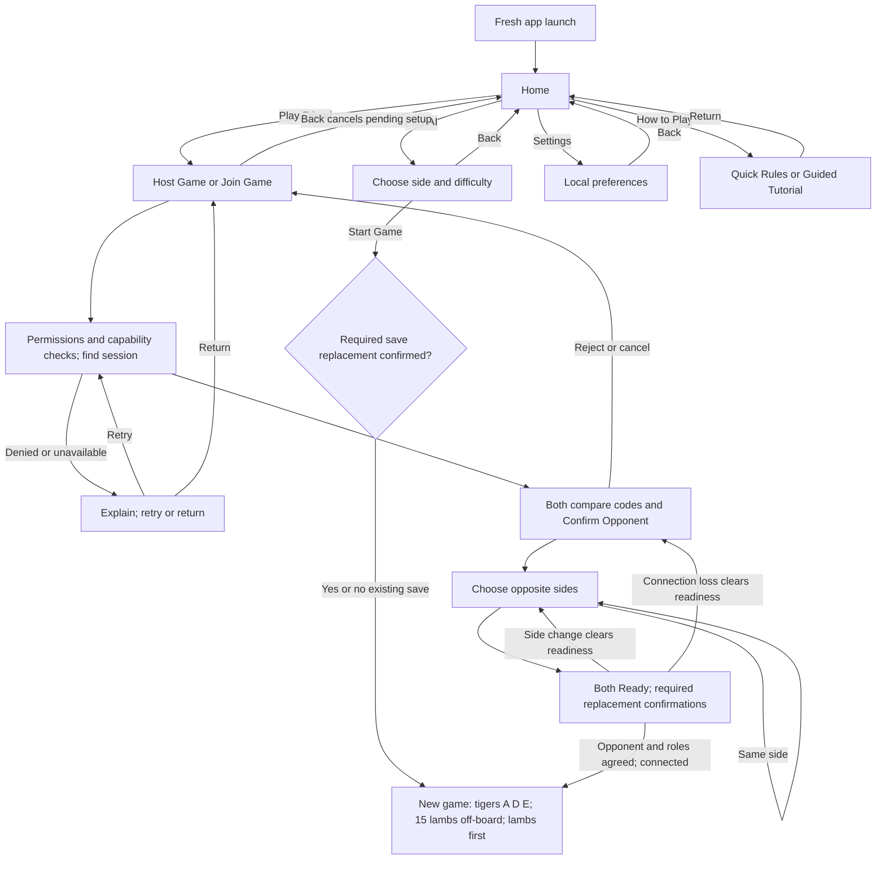
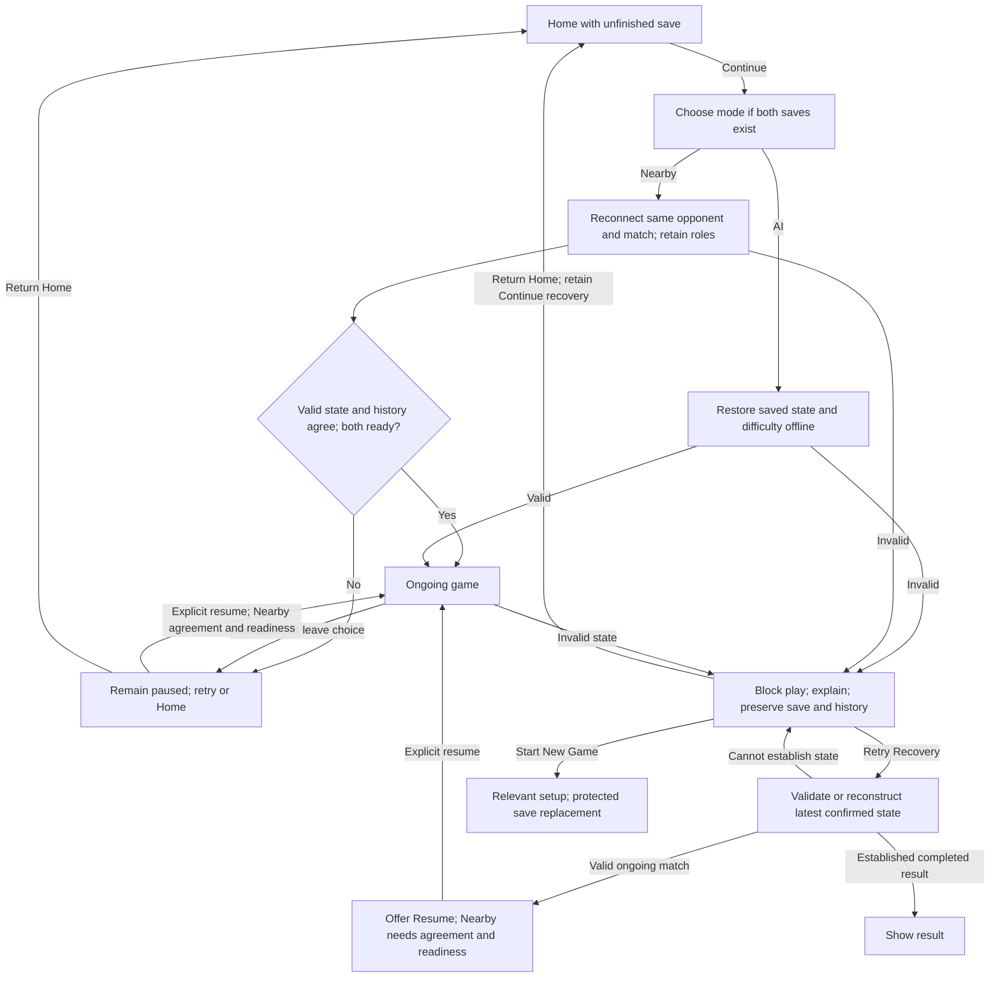
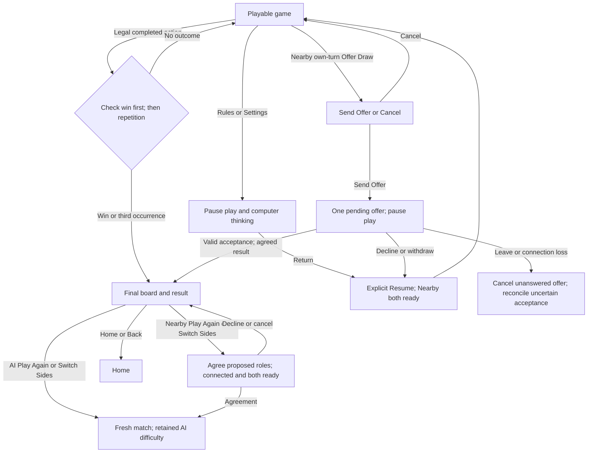

# V1 screen flows and acceptance criteria

Status: **approved screen-flow and acceptance-criteria baseline for issue #2 (D033)**, 2026-10-17. The user approved this consolidation of D018–D032, including the screen inventory, three flow sketches, and AC01–AC51. See [issue #2](https://github.com/lumensparkxy/lamb-and-tiger/issues/2). This records specification approval, not architecture approval, implementation, or verification results.

Authority: the [product brief](brief.md) contains the full approved wording, the [decision log](../decisions.md) records approval scope, and the [game-rules baseline](game-rules.md) governs board geometry, legal actions, and outcomes. The criteria below are future verification requirements, not executed tests or evidence of a working app.

## Scope and screen inventory

V1 targets Play AI (Solo) and Play Friend (Nearby on two phones), without app accounts. Nearby remains subject to the two-physical-phone feasibility experiment; failure requires an explicit scope decision. Pass & Play and internet multiplayer remain V2/later.

| Screen or state | Contents and actions | Entry and exit |
| --- | --- | --- |
| Home | Primary: **Play AI** / **Challenge the computer**, **Play Friend** / **Play nearby on two phones**. Secondary: **Settings**, **How to Play**, contextual **Continue**. | Fresh launch opens Home. Opening Home starts no match or permission request. |
| AI setup | Tiger/Lamb selection, all five difficulty names, labels, and descriptions; **Start Game**. | Home → setup → explicit start; Back cancels. Existing-save replacement follows D020. |
| Nearby Host/Join | **Host Game**, **Join Game**; recognisable host session label or selectable session list. | Home → Host/Join → permission/capability checks and discovery. Denial/unavailability offers explanation and retry/return. |
| Opponent confirmation | Matching short codes on both phones; **Confirm Opponent**, rejection/cancellation. | Both confirm before side selection. Rejection/cancellation ends pairing and returns to Host/Join. |
| Nearby sides/readiness | Both side selections, conflict explanation, both readiness states; **Ready** and cancel readiness. | Opposite roles, confirmed opponent, both ready, and required save-replacement confirmation gate the new match. |
| Continue chooser/resume | Select mode if both saves exist; restore AI or reconnect the same Nearby opponent and match with saved roles. | Home → Continue. Invalid saves enter recovery; unavailable/mismatched Nearby remains paused. |
| Game | Approved board, mode, player side, turn, AI difficulty, phase, reserve and captured counts, action feedback. | Legal input only when playable. AI has Hint/Undo; menu has Rules, Settings, Save & Return Home, and Nearby Offer Draw. |
| Paused/leave state | **Keep Playing**, **Save & Return Home** for exit confirmation; **Resume** on returning to an existing interrupted game screen. | Stop play/computer thinking. Nearby requires mutual readiness and state/history agreement before further moves. |
| Draw confirmation/pending | **Send Offer**, **Cancel**; then sender **Waiting for your friend** / **Withdraw Offer**, opponent **Accept Draw** / **Decline**. | Own-turn connected Nearby only; pending offers pause play. Outcome and resume follow D028. |
| Result/rematch | **Tigers Win**, **Lambs Win**, or **Draw**, reason, player side, final board/count; **Play Again**, **Switch Sides**, **Home**. | No further moves. Nearby rematches require agreement on proposed roles and mutual readiness. Home/Back returns Home. |
| How to Play | **Quick Rules**, **Guided Tutorial**. | Home entry; optional learning, clear route Home, no automatic game start. |
| Quick Rules/tutorial | Illustrated scrollable rules; selectable interactive lessons with retry/skip/exit. | Tutorial is Home-only and independent of matches. In-game Rules pauses the game and returns through explicit resume. |
| Settings | Modern/Midnight Prowl previews; Sound Effects, Vibration, Reduced Motion. | Home or game menu. Return to origin; game entry pauses play and return requires explicit resume. |
| Invalid-state recovery | **“This game cannot continue safely.”**, plain-language reason, **Retry Recovery**, **Return Home**, **Start New Game**. | Keep play blocked until the latest confirmed valid state/result is established. Protect saves and history throughout. |

These are logical screens/states, not a prescribed number of Android destinations or final visual layouts. English labels are source wording; D031 requires reviewed Tamil equivalents.

## Flow sketches

### Home and new games

A reconnect must succeed before repeating opponent confirmation. Back from any pre-match step returns to the previous screen; leaving Nearby setup cancels discovery/hosting/pending connection. Cancelling setup never replaces a save or creates a result. Replacement occurs only when the new match actually starts. Host is a discovery role, not an approved choice of match authority.

### Continue, interruption, and recovery

Fresh launch always opens Home. Continue is an explicit action; an app returning to an existing interrupted game screen shows Resume. Neither reopening nor recovery auto-resumes. Uncertain moves/saves stay blocked; never duplicate completed actions, silently rewind, or claim unsaved progress was saved. Recovery is separate from the explicit Solo Undo allowed by D024.

### Play, draw offers, results, and supporting screens

Opening the game menu alone does not pause; entering Rules, Settings, or exit confirmation does. A pending draw cannot override a completed win. Delayed offers/responses cannot affect a later position/rematch. Rematch resets the opening, capture count, move/repetition history (initial position counted once), and draw offers. No automatic role alternation occurs.

## Observable acceptance criteria

All rows are **not yet executed**. Each row identifies an observable scenario and its approved source; the complete source rules still apply. Future test records should reference these IDs and record build, device/environment, procedure, result, and evidence. Exact test fixtures and technical mechanisms remain later work.

### Home, setup, and opponent confirmation

| ID | Scenario and expected observation | Source |
| --- | --- | --- |
| AC01 | Fresh launch shows Home with exact approved primary labels/subtitles, Settings and How to Play. No match starts and no Nearby permission prompt appears. Pass & Play/internet multiplayer are absent. | D007–D008, D018–D019, D023 |
| AC02 | AI setup offers Tiger/Lamb and all five approved names, labels, descriptions, unlocked for either side. First default is Baa-sic Instinct — Easy; subsequent new-game default is the most recently started AI match's difficulty. Cancelling setup does not establish a new started-match default. | D019, D026 |
| AC03 | Start Game creates the approved opening with lambs first. A human Tiger sees the computer make the opening lamb placement; a human Lamb places first. Difficulty remains fixed, with no hidden adjustment; all levels use identical rules offline. | D011, D019, D026 |
| AC04 | Existing same-mode save requires explicit replacement confirmation. Opening/cancelling setup preserves it; replacement happens only on actual start. The other mode's save is untouched. | D020, D027 |
| AC05 | Host shows a recognisable session label; Join lists sessions for selection. Neither discovery nor selection starts play. Host/Join triggers required permissions/capability checks. | D019, D027, D031 |
| AC06 | Denied permissions, unavailable Nearby capability, or no available opponent shows an explanation and retry/return. AI, tutorials, and Settings remain usable. Retry does not bypass the unmet requirement. | D019, D031 |
| AC07 | Pairing shows matching short codes and requires Confirm Opponent on both phones. Mismatched codes, rejection, or cancellation cannot start a match; rejection/cancellation returns to Host/Join and preserves saves. No account/real name is required. | D027 |
| AC08 | Both selections and readiness states are visible. Same-side selection blocks Ready; opposite sides permit it. Changing a side clears both readiness confirmations; a ready player can cancel readiness. Host has no side priority. | D027 |
| AC09 | Start requires agreed opponent/roles, both ready, connection, and required replacement confirmations. Each game screen identifies You are Tigers/You are Lambs. Loss during setup clears readiness; reconnect requires repeated opponent confirmation and role review. | D020, D027 |
| AC10 | Back before start returns to the previous screen; leaving Nearby setup cancels searching/hosting/pending connection. No setup cancellation creates a game result. | D019, D027 |

### Play, assistance, and outcomes

| ID | Scenario and expected observation | Source |
| --- | --- | --- |
| AC11 | The 23-point board preserves the approved graph. Game displays mode, player's side, turn, AI difficulty where applicable, Placement phase/Movement phase, Lambs to place: N, and Lambs captured: N / 5. Placement explains that placed lambs cannot move yet. | D017, D029 |
| AC12 | Human lamb placement uses one empty-point tap without reserve selection, drag, or extra confirmation. Movement/capture uses piece then legal destination; tapping the selection deselects and another own piece changes it. Illegal taps explain without mutation. Capture destinations differ beyond colour. | D013, D024, D029 |
| AC13 | Approved rule examples E01–E21 govern legal moves/outcomes. In particular, captures are optional single straight jumps, lambs cannot move until all placements finish, and no invalid lamb turn automatically passes. | D012–D017; game-rules.md |
| AC14 | Opponent/computer turns, pauses, pending draws, uncertain state/connection, and terminal games block board actions. Rapid repeated input cannot duplicate or queue actions while resolving. Status identifies thinking/waiting/paused/confirming states. | D029 |
| AC15 | Confirmed action feedback marks origin/destination or placement, identifies captured lambs, clears selection, and updates counts/turn/phase. Reduced Motion preserves understandable feedback without decorative animation. | D025, D029 |
| AC16 | On an eligible AI human turn, unlimited offline Hint at every level highlights one legal action without playing it, altering state/history, or promising optimality. Position changes clear hints; stale calculations are discarded. | D024, D026 |
| AC17 | Eligible AI Undo restores before the latest human action, removing that action and computer reply, including counts/phase/turn/history. Repeated Undo reaches earlier human turns; no standalone undo of the computer opening is allowed. Remaining history persists through Continue; no new occurrence or Redo is introduced. | D024 |
| AC18 | Hint/Undo are unavailable on computer turns, while paused/invalid, and after completion; Undo is also unavailable before a human action. Explain unavailability. Neither affects difficulty or incurs a penalty. Nearby has legal highlights but no strategic hints/undo/takebacks. | D024, D026 |
| AC19 | Five total captures wins for tigers; all three tigers with no ordinary move or capture wins for lambs. Check immediately after every completed action, including placement. No further move follows a result. | D014 |
| AC20 | Third occurrence draws using species occupancy, side to move, phase, reserve and captured counts; ignore same-species identities. Wins have priority. Initial position counts once; reading/resuming/redrawing and non-move UI events add no occurrence. Undo removes undone occurrences as approved. | D015, D017, D024 |

### Continue, interruptions, and recovery

| ID | Scenario and expected observation | Source |
| --- | --- | --- |
| AC21 | Home offers Continue for an unfinished save; with both independent mode saves it offers a chooser. Completed games are not playable Continue entries. Invalid saves explain the problem and preserve access to recovery; discard requires confirmation. | D020, D032 |
| AC22 | Initial match and every completed legal action are saved with board, turn, phase, reserve/captured counts, roles, repetition history, and AI difficulty; remaining move history supports Undo. Offline AI Continue restores these without duplicate computer actions or repetition occurrences. | D020, D024 |
| AC23 | Nearby Continue retains saved roles and requires the same opponent/match, mutual confirmation, and matching state/history. Unavailable opponent or mismatched saves stays paused with retry/Home; no silent restart, rollback, or AI substitution. | D020, D027 |
| AC24 | Back during play pauses local play/thinking and offers Keep Playing / Save & Return Home. Save & Return Home preserves the latest completed position. Either Nearby player may leave without permission; notify the connected peer and pause it. Cancelling Nearby exit still requires mutual readiness. | D021 |
| AC25 | Backgrounding, lock, loss of foreground, and Nearby loss pause play; peer pauses on detection. Return to the existing game screen requires explicit Resume; fresh launch opens Home and uses Continue. App termination restores from the save without duplicate moves. | D020–D021 |
| AC26 | Unconfirmed in-flight moves/save failures block play, preserve completed actions, and offer retry/return. If latest progress was not saved, show that warning and never falsely claim saved. Departure/disconnection/replacement creates no result, timeout loss, forfeiture, or resignation. | D021 |
| AC27 | Invalid state, including ongoing lamb turn without legal action, blocks moves/computer/hints/undo/draw offers without pass or result. Show “This game cannot continue safely.”, plain reason where known, and Retry Recovery / Return Home / Start New Game in the selected language without technical dumps. | D016, D031–D032 |
| AC28 | Recovery preserves saves and available move/repetition history; never overwrites a usable save with known invalid data, silently deletes, or resets. Return Home retains recovery through Continue. Retry cannot invent moves, rewind, or discard history; inability to establish latest confirmed state remains blocked. | D032 |
| AC29 | Invalid Nearby state notifies the connected opponent and pauses both on detection/communication. Recovery requires same opponent/match, valid state/history and completed-result agreement, and mutual readiness. Neither phone can declare unilateral repair. | D032 |
| AC30 | Successful ongoing recovery offers explicit Resume; an established completed outcome shows its result. Failure explains and retains recovery actions. Start New Game uses relevant setup and protected replacement only at actual start; cancellation preserves the old save and the other mode is untouched. | D020, D032 |

### Draw interaction and rematches

| ID | Scenario and expected observation | Source |
| --- | --- | --- |
| AC31 | Offer Draw is available only on the offering player's turn in ongoing connected Nearby play, never AI/setup/paused/uncertain/terminal. Confirmation says “Offer your friend a draw?” with Send Offer / Cancel. Cancel sends nothing and changes no state. | D028 |
| AC32 | Sending pauses play for one pending offer with the approved sender/opponent actions. Silence/timeout never accepts. A valid explicit acceptance gives Draw — By agreement only after both confirm the same result, never overriding an already completed win. | D028 |
| AC33 | Decline/withdraw keeps position/turn and creates no result; both ready before resume. Unanswered offers cancel on departure/loss and do not reappear with Continue. Uncertain acceptance remains paused for reconciliation, without guessing or erasing a result. | D028 |
| AC34 | Offers/responses are match/position-bound; a changed position or completion invalidates an offer. Delayed responses cannot affect a later position/rematch. Offers, responses, and readiness never add repetition occurrences. | D028 |
| AC35 | Results show Tigers Win/Lambs Win/Draw with the approved reason, player side, final board/captured count, and no playable actions. Home/Back returns Home without active-game exit warning. Existing interrupted result screen restores the result; fresh launch opens Home. | D022 |
| AC36 | AI Play Again retains side/difficulty; Switch Sides swaps side at the same difficulty. Changing difficulty requires Home/setup. Nearby proposes same/swapped roles visibly and starts only with agreement and both ready; decline/cancel is allowed, disconnection blocks start, prior result stays final. | D022 |
| AC37 | No automatic side alternation. Every rematch restores tigers A/D/E, 15 off-board lambs, lambs first, zero captures, fresh move/repetition history with initial count one, and no old offers; save under D020. | D011, D020, D022 |

### Learning and preferences

| ID | Scenario and expected observation | Source |
| --- | --- | --- |
| AC38 | How to Play offers optional offline illustrated Quick Rules and Guided Tutorial. Rules cover approved board/setup, phases, movement, optional single captures without chains, wins/draws, lambs first, and explicit Nearby agreement. | D023 |
| AC39 | Tutorial practises placement, lamb/tiger movement, capture, wins/draws with explanations, retry, skip, and exit. Any lesson is selectable; reopening shows lesson list without saved tutorial progress. Practice changes no real save, difficulty, or history; completion returns to How to Play, never auto-starting. | D023 |
| AC40 | In-game Rules and Settings pause play/computer thinking and return through explicit Resume plus Nearby readiness. The menu alone does not pause. Tutorial remains accessed from Home; Settings opened from Home returns Home. | D021, D023, D025, D029 |
| AC41 | Settings offers Modern default light and Midnight Prowl dark, each with board preview; no other V1 themes. Theme changes preserve match/roles/turn/difficulty/history and readable geometry, pieces, selection, and destinations; distinguish species by shape and colour. | D025 |
| AC42 | Sound Effects and Vibration are independent and default Off. Sound uses short move/capture/result cues, no music, device controls respected and visual equivalents retained. Vibration uses brief player-completed-action feedback; unavailable control is disabled with explanation. | D025 |
| AC43 | Reduced Motion defaults on when the device requests it and removes decorative movement. Preferences apply immediately, persist across restarts per phone, and never replace saves; Nearby phones can differ. Roles/difficulty stay in setup. | D025 |

### Accessibility, devices, languages, and difficulty evaluation

| ID | Scenario and expected observation | Source |
| --- | --- | --- |
| AC44 | Phone/tablet portrait/landscape preserves board geometry, with controls below on narrow screens and beside on wide screens. Rotation/resizing preserves match, turn, selection, preferences, and history without duplicate actions or bypassing pause. | D030 |
| AC45 | Buttons/controls provide at least 48 × 48 dp targets. Dense points have an accessible point-selection list using the same placement/piece/destination actions; a full game needs no dragging. | D030 |
| AC46 | At 200% system text size, essential text/actions remain available using wrapping/scrolling instead of shrinking. Both themes meet at least 4.5:1 text contrast with shape/text distinctions. Important errors/connection messages persist until resolved/dismissed. | D030 |
| AC47 | A complete game is playable using TalkBack: labelled points, occupancy, selection and actions, predictable focus, and turn/capture/pause/error/result announcements that do not repeatedly interrupt navigation. Essential feedback never relies solely on colour/sound/vibration/animation. | D030 |
| AC48 | Verify Android 10+ scope subject to scaffold dependency validation, initial Android 16/API 36 target with release-time requirement recheck, relevant intermediate permission behaviour, and current stable Android. Record concrete devices/OS versions; Nearby evidence needs two physical phones. | D031 |
| AC49 | Minimum content area excludes system bars: 320 × 480 dp portrait or 480 × 320 dp landscape. Below these dimensions show resize/rotate guidance, preserve the match, and pause active play. | D031 |
| AC50 | System English selects English; Tamil ta including regional variants selects reviewed Tamil; unsupported languages fall back to English. All app text, tutorials/rules/status/errors and accessibility labels localize; no in-app selector. Resources allow extension with complete English fallback; verify Tamil wrapping/TalkBack and difficulty terminology. | D031 |
| AC51 | Run fixed AI scenarios and repeated games with every level as both sides; record legal play, strength and response time. Build easiest/strongest first and tune intermediate levels; unresolved adjacent-level differences require tuning or explicit plan review. Expert is not an optimal/unbeatable claim. Numeric thresholds and fixtures still need approval during implementation planning. | D026 |

## Decision coverage and verification boundaries

| Approved source in product brief | Consolidated coverage |
| --- | --- |
| [D018 Home labels](brief.md#approved-home-labels-d018) | Home inventory; AC01 |
| [D019 navigation/setup](brief.md#approved-home-navigation-and-setup-d019) | New-game sketch; AC01–AC10 |
| [D020 saves/Continue](brief.md#approved-continue-and-saved-game-behaviour-d020) | Continue sketch; AC04, AC21–AC23, AC30, AC37 |
| [D021 departures/interruptions](brief.md#approved-active-game-departure-and-interruptions-d021) | Pause sketch; AC24–AC26, AC40 |
| [D022 result/rematch](brief.md#approved-result-screen-and-rematches-d022) | Result sketch; AC35–AC37 |
| [D023 learning](brief.md#approved-tutorial-and-rules-access-d023) | Learning inventory; AC38–AC40 |
| [D024 hints/undo](brief.md#approved-hints-and-undo-d024) | AC12, AC16–AC18, AC20, AC22 |
| [D025 Settings](brief.md#approved-settings-and-defaults-d025) | Settings inventory; AC40–AC43 |
| [D026 AI levels](brief.md#approved-ai-difficulty-levels-and-behaviour-d026) | AI setup; AC02–AC03, AC18, AC51 |
| [D027 opponent/side agreement](brief.md#approved-nearby-opponent-confirmation-and-side-selection-d027) | Nearby setup sketch; AC05, AC07–AC10, AC23 |
| [D028 draw interaction](brief.md#approved-nearby-draw-offer-interaction-d028) | Draw sketch; AC31–AC34 |
| [D029 game interaction](brief.md#approved-game-screen-interaction-and-status-d029) | Game inventory; AC11–AC15, AC40 |
| [D030 accessibility/layouts](brief.md#approved-accessibility-and-screen-layouts-d030) | AC44–AC47 |
| [D031 devices/languages](brief.md#approved-device-support-and-languages-d031) | AC06, AC27, AC48–AC50 |
| [D032 recovery](brief.md#approved-invalid-game-state-recovery-d032) | Recovery sketch; AC27–AC30 |

Documentation review can check source consistency, flow coverage, links, and explicit unresolved decisions. It cannot prove runtime acceptance. Later verification must distinguish:

- Deterministic engine checks against approved board/rule examples and saved/repetition/undo invariants.
- Rendered UI and emulator/device checks for navigation, interruptions, error states, layouts, accessibility, settings, and both languages.
- Two-physical-phone Nearby checks for discovery, permissions, confirmation, play, save/resume, connection loss, uncertain actions/draws, recovery, and rematches. Unit tests or emulators alone do not prove connectivity.
- AI legality, measured strength and response-time evaluation; neither names nor UI completion proves difficulty progression.
- Release checks for current platform/store requirements and the actual SDK/privacy/distribution choices. No build/test commands exist yet.

## Issue #2 coverage and publication status

| GitHub issue acceptance item | Consolidation evidence | Status |
| --- | --- | --- |
| Sketch Home, Solo setup, Nearby host/join/confirmation, game, result, Settings; only Solo/Nearby primary play actions | Screen inventory and three flow sketches | Approved baseline in D033 |
| Resolve tutorial, hints, undo, Continue, sound, initial themes | Approved D020, D023–D025; AC16–AC18, AC21–AC23, AC38–AC43 | Decisions recorded; consolidation approved in D033 |
| Observable criteria including permission denial, unavailable opponent, interrupted sessions | AC06, AC23–AC30 and full AC01–AC51 catalogue | Defined for future verification; not executed |
| README, decisions, open questions reflect private repo and link milestones; architecture remains proposed | Linked planning references and verified milestone URLs | Documentation included in approved baseline |
| Pass & Play and internet multiplayer remain V2/later | Scope statement and AC01 | Preserved |

The user approved the consolidated issue #2 baseline in D033. The user subsequently authorized committing/pushing the approved baseline, updating GitHub, and closing issue #2. See [issue #2](https://github.com/lumensparkxy/lamb-and-tiger/issues/2) for publication and completion evidence. This authorization explicitly stops before issue #3; no implementation is started by this document.

Open work stays in [open questions](../open-questions.md): Nearby transport feasibility and protocol authority/order/opponent identity/reconciliation; recovery validation/reconstruction; AI algorithms and numeric evaluation thresholds; exact visuals/assets; concrete test devices/window matrix; reviewed Tamil terminology; and business/release decisions. At issue #2 baseline approval, Kotlin/Compose, the three-module split, and Google Nearby Connections were proposals. D037 subsequently approves Kotlin/Jetpack Compose and the module boundaries in the [architecture record](../architecture/module-boundaries.md); Google Nearby Connections remains a transport candidate. The existing private repository/owner is established; any future change of ownership/visibility is a separate choice.
